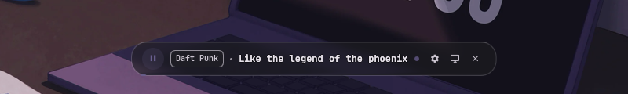
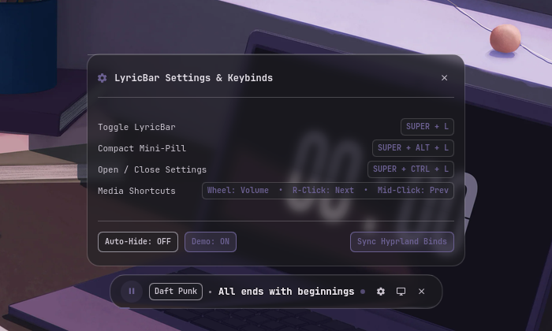
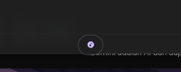
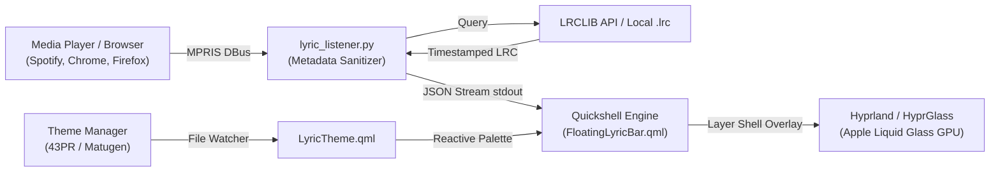

# Quickshell Floating LyricBar

[](https://hyprland.org)
[](https://quickshell.outfoxxed.me)
[](https://github.com)
[](https://lrclib.net)
[](https://python.org)
[](LICENSE)

An ultra-refined, floating synchronized lyric capsule built with **Quickshell** for Wayland and Hyprland desktops. Designed with Apple Liquid Glass (`hyprglass`) hardware refraction effects, dynamic content-driven auto-resizing, fluid Dynamic Island spring morphology, instant real-time theme synchronization, and universal browser media support including YouTube Music.

---

## Visual Showcase

### Full Synchronized Lyric Capsule
Floating liquid glass capsule displaying real-time synchronized lyrics, artist badge, tactile media playback controls, and active lyric pulse indicator.



---

### Liquid Glass Settings and Keybindings Modal
Interactive modal with hotkey reference, instant Hyprland shortcut synchronization, and persistent playback behavior toggles.



---

### Compact Dynamic Island Mini-Pill
Seamless physical morph into a compact glass pill with breathing music note indicator and fluid spring physics.



---

## Architectural Highlights

### 1. Unified Dynamic Island Morphology
Rather than toggling separate widgets on and off, the bar uses a single unified capsule that physically stretches, contracts, and morphs in place:
- **Geometry Morphing:** Transitions between full bar (`300px` to `780px` width, `44px` height, `20px` radius) and compact mini-pill (`44px` width, `34px` height, `17px` radius) with `Easing.OutBack` spring physics.
- **Content Cross-Fade:** Smoothly interpolates opacity and scale between full playback controls and the mini music icon without layout popping or tearing.

### 2. Apple Liquid Glass Hardware Refraction
- Fully integrated with the `hyprglass` composition plugin using the `pomme` preset.
- Dual-layer glass structure with top specular edge highlights (`glassHighlight`) and interactive 3D parallax tilt tracking cursor position on hover.

### 3. Dynamic Content-Driven Sizing
- Measures the exact rendered width of active lyric strings offscreen every second.
- Expands and contracts the container width dynamically with gentle dampening, ensuring zero layout snapping.

### 4. Apple Music Subtitle Text Transitions
- Lyric line changes animate using a vertical slide (`y: 9px -> 0px`), scale spring (`0.95 -> 1.0`), and cross-fade (`opacity: 0.0 -> 1.0`).
- Text rendering uses `Text.NativeRendering` with subtle contrast outline protection, ensuring high legibility over dark or bright wallpapers.

### 5. Universal Browser and YouTube Music Support
- Connects to any MPRIS-compliant player: Spotify, Amberol, MPD, VLC, Cider, and web browsers.
- Specialized metadata sanitizer for Google Chrome, Chromium, Mozilla Firefox, Brave, and Zen Browser.
- Automatically strips video noise tags (`Official Music Video`, `Lyric Video`, `4K`, `MV`, etc.), topic channels (`- Topic`), `VEVO` suffixes, and extracts artist/title from compound strings (`Artist - Title`).
- Queries synchronized timestamps from [LRCLIB.net](https://lrclib.net) with multi-tier fallback (exact match, search queries, and duration proximity filtering).

### 6. Real-Time Palette Synchronization
- Tracks active desktop theme files (`~/.cache/43pr/quickshell-theme.json`, `~/.local/state/quickshell/user/generated/colors.json`, and `color.txt`).
- Watches file changes with atomic-safe inotify reloaders to update colors and glass tints in real-time without restarting the widget.

---

## System Architecture



---

## Installation

### Automated One-Line Installer

Run the following command in your terminal:

```bash
bash -c "$(curl -fsSL https://raw.githubusercontent.com/DX4GREY/quickshell-lyricbar/main/install.sh)"
```

### Manual Installation

Clone the repository and run the setup script:

```bash
git clone https://github.com/DX4GREY/quickshell-lyricbar.git
cd quickshell-lyricbar
./install.sh
```

If LyricBar is already installed on the system, the installer detects the existing setup and presents an interactive menu to Repair / Update or Uninstall. You can also supply flags directly:

```bash
# Repair or update an existing installation
./install.sh --repair

# Completely uninstall LyricBar
./install.sh --uninstall
```

Upon successful installation or repair, the installer automatically launches the LyricBar daemon in the background. Pass `--no-start` if you want to skip immediate execution.

### System Prerequisites

Ensure the following packages are installed on your distribution:

| Dependency | Purpose | Arch Linux Package | Fedora Package |
| :--- | :--- | :--- | :--- |
| `quickshell` | Wayland desktop shell framework | `quickshell-git` (AUR) | Copr / Source |
| `python3` | Lyric synchronization listener | `python` | `python3` |
| `python-dbus` | MPRIS DBus session interface | `python-dbus` | `python3-dbus` |
| `playerctl` | Media controls and status fallback | `playerctl` | `playerctl` |
| `hyprland` | Wayland compositor | `hyprland` | `hyprland` |

---

## Keybindings and Ergonomics

To prevent collisions with standard Hyprland system hotkeys (specifically `SUPER + L`, which is reserved for session locking via `loginctl lock-session`), LyricBar utilizes the non-conflicting `Y` series:

| Keybinding | Action | Command Executed |
| :--- | :--- | :--- |
| `SUPER + Y` | Toggle LyricBar visibility | `qs -c lyricbar ipc --any-display call lyricbar toggle` |
| `SUPER + ALT + Y` | Toggle Compact Mini-Pill | `qs -c lyricbar ipc --any-display call lyricbar toggleMini` |
| `SUPER + CTRL + Y` | Toggle Settings & Keybinds Modal | `qs -c lyricbar ipc --any-display call lyricbar toggleSettings` |

### Interactive Media Controls
- **Play / Pause:** Left-click the disc button (`playerctl play-pause`).
- **Volume Adjustment:** Scroll mouse wheel anywhere over the capsule (`playerctl volume +/-`).
- **Next Track:** Right-click anywhere on the capsule (`playerctl next`).
- **Previous Track:** Middle-click anywhere on the capsule (`playerctl previous`).
- **Expand from Compact:** Left-click the mini-pill to expand back into the full bar.

---

## Hyprland Integration

### 1. Autostart Configuration
The installer automatically registers LyricBar autostart in `~/.config/hypr/custom/execs.lua`, ensures `~/.local/bin` is exported in `~/.config/hypr/custom/env.lua`, and creates an XDG autostart desktop entry in `~/.config/autostart/quickshell-lyricbar.desktop`.

For manual Hyprland Lua configuration, ensure this line exists in `~/.config/hypr/custom/execs.lua`:

```lua
hl.on("hyprland.start", function ()
    hl.exec_cmd("sleep 2 && " .. (HOME or (os.getenv("HOME") or "")) .. "/.local/bin/quickshell-lyricbar --background")
end)
```

For standard `hyprland.conf` without Lua:

```ini
exec-once = sleep 2 && ~/.local/bin/quickshell-lyricbar --background
```

### 2. Register Hotkeys in Hyprland
Add the keybindings to `~/.config/hypr/custom/keybinds.lua` (or click "Sync Hyprland Binds" inside the Settings modal):

```lua
-- Quickshell LyricBar Keybindings
hl.bind("SUPER + Y", hl.dsp.exec_cmd("qs -c lyricbar ipc --any-display call lyricbar toggle"), { description = "LyricBar: Toggle visibility" })
hl.bind("SUPER + ALT + Y", hl.dsp.exec_cmd("qs -c lyricbar ipc --any-display call lyricbar toggleMini"), { description = "LyricBar: Toggle mini pill" })
hl.bind("SUPER + CTRL + Y", hl.dsp.exec_cmd("qs -c lyricbar ipc --any-display call lyricbar toggleSettings"), { description = "LyricBar: Toggle settings" })
```

For standard `hyprland.conf` syntax without Lua:

```ini
bind = SUPER, Y, exec, qs -c lyricbar ipc --any-display call lyricbar toggle
bind = SUPER ALT, Y, exec, qs -c lyricbar ipc --any-display call lyricbar toggleMini
bind = SUPER CTRL, Y, exec, qs -c lyricbar ipc --any-display call lyricbar toggleSettings
bind = , XF86AudioPlay, exec, qs -c lyricbar ipc --any-display call lyricbar playPause
```

### 3. HyprGlass Layer Composition Rule
The installer automatically verifies this rule in `~/.config/hypr/custom/general.lua`:

```lua
if hl.plugin.hyprglass then
    local hg = hl.plugin.hyprglass
    -- Quickshell Floating LyricBar (Apple Liquid Glass)
    hg.layer("quickshell:lyricbar", { preset = "pomme", mask_threshold = 0.01, mask_feather = 0.45 })
end
```

---

## Configuration Reference

User preferences are persisted in `~/.config/quickshell/lyricbar/config.json`:

```json
{
  "autoHideOnStop": true,
  "anchorTop": false,
  "horizontalAlign": "center",
  "offsetY": 28,
  "marginSide": 32,
  "showProgressBar": true,
  "showArtistBadge": true,
  "showPlayButton": true,
  "showPulseDot": true,
  "enableParallax": true,
  "fontSizeDelta": 0,
  "bindToggle": "SUPER + Y",
  "bindToggleMini": "SUPER + ALT + Y",
  "bindToggleSettings": "SUPER + CTRL + Y",
  "demoMode": false
}
```

| Property | Type | Default | Description |
| :--- | :--- | :--- | :--- |
| `autoHideOnStop` | Boolean | `true` | Automatically hides the capsule when playback is stopped or paused, and restores it when playback resumes. |
| `anchorTop` | Boolean | `false` | Positions the capsule at the top screen edge when `true`, or bottom screen edge when `false`. |
| `horizontalAlign` | String | `"center"` | Horizontal positioning mode: `"center"`, `"left"`, or `"right"`. |
| `offsetY` | Integer | `28` | Vertical edge offset distance in pixels (`16`, `28`, `44`, `64`). |
| `marginSide` | Integer | `32` | Side edge offset distance in pixels when aligned left or right. |
| `showProgressBar` | Boolean | `true` | Toggles the active track duration progress bar along the capsule bottom. |
| `showArtistBadge` | Boolean | `true` | Toggles the glass artist name pill badge. |
| `showPlayButton` | Boolean | `true` | Toggles the media disc play/pause button. |
| `showPulseDot` | Boolean | `true` | Toggles the pulsating synchronicity dot during lyric playback. |
| `enableParallax` | Boolean | `true` | Enables subtle 3D interactive parallax tilt following cursor motion. |
| `fontSizeDelta` | Integer | `0` | Lyric text size adjustment (`-2` for 10px, `0` for 12px, `2` for 14px, `4` for 16px). |
| `bindToggle` | String | `"SUPER + Y"` | Keybinding to toggle LyricBar visibility. |
| `bindToggleMini` | String | `"SUPER + ALT + Y"` | Keybinding to toggle compact mini-pill mode. |
| `bindToggleSettings` | String | `"SUPER + CTRL + Y"` | Keybinding to open/close settings modal. |
| `demoMode` | Boolean | `false` | Runs internal synchronized sample lyrics for UI testing without an active media player. |

---

## IPC Interface Reference

All functions can be called from terminal, scripts, or window manager keybinds using the standard Quickshell IPC client:

```bash
qs -c lyricbar ipc --any-display call lyricbar <FUNCTION>
```

| Function Name | Description |
| :--- | :--- |
| `toggle` | Smoothly toggles capsule visibility with Apple entrance/exit spring animation. |
| `show` | Displays the capsule. |
| `hide` | Dismisses the capsule. |
| `toggleMini` | Morphs between full lyric capsule and compact mini-pill. |
| `toggleSettings` | Opens or closes the settings and keybindings modal. |
| `openSettings` | Opens the settings modal. |
| `closeSettings` | Closes the settings modal. |
| `playPause` | Toggles play/pause on the active player. |
| `next` | Skips to the next track. |
| `prev` | Returns to the previous track. |
| `applyHyprlandKeybinds` | Syncs recommended keybinds into `custom/keybinds.lua`. |

Theme reloads can be triggered via:
```bash
qs -c lyricbar ipc --any-display call lyrictheme reload
```

---

## CLI Usage

The executable wrapper `quickshell-lyricbar` provides quick control:

```bash
# Launch interactive foreground instance
quickshell-lyricbar

# Launch background daemon
quickshell-lyricbar --background

# Launch in demonstration mode
quickshell-lyricbar --demo

# Terminate running instances
quickshell-lyricbar --kill

# Send IPC commands
quickshell-lyricbar ipc call lyricbar toggle
```

---

## Uninstallation

To cleanly remove Quickshell LyricBar from your system:

```bash
quickshell-lyricbar --kill
./install.sh --uninstall
```

Alternatively, running `./install.sh` on an existing installation displays an interactive menu where option `2` triggers complete removal.

The uninstaller removes component files from `~/.config/quickshell/lyricbar/`, the executable wrapper from `~/.local/bin/quickshell-lyricbar`, and desktop autostart configurations.

---

## License

Released under the [MIT License](LICENSE). Designed for Quickshell and Hyprland desktop environments.
